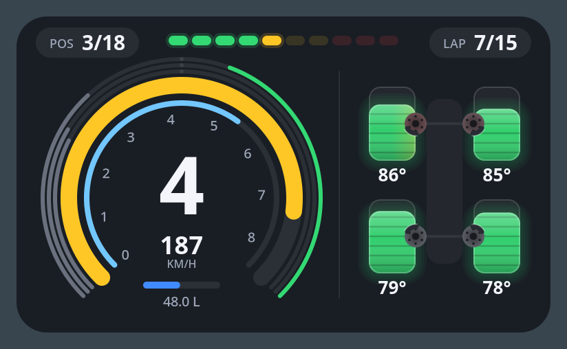

# AMS2 Overlay

A compact racing dashboard overlay for **Automobilista 2** on Linux (Wayland). It reads
the game's UDP telemetry and draws a small panel on top of the game.



## What it shows

- **Rev arc** with shift lights, and the gear in the middle
- **Speed** as an inner arc and a readout; the arc's scale learns the car's top speed
  once you use top gear
- **Fuel** under the speed; the gear blinks with a fuel pump icon when you are nearly empty
- **Clutch, brake and throttle** arcs on the right of the gauge, and **water temperature,
  oil temperature and oil pressure** arcs on the left
- **Tyres** as a heat map across the tread (inside, centre, outside), with wear shown by
  how much rubber is left
- **Brake discs** that glow as they heat up
- **Damage** to suspension, wings, engine and brakes, shown on the car outline only once
  there is some
- **Proximity radar**: the panel edge glows where a car is alongside you
- **Position** and **lap** (or **time remaining** in timed sessions)
- **Flags**: the shift lights take on the flag's colour and pattern, and a small waving
  flag replaces the fuel readout while a flag is out

## Requirements

- Linux with a Wayland compositor that supports the layer-shell protocol (KDE Plasma,
  Hyprland, Sway, niri, …)
- Python 3, PyGObject, GTK 4 and pycairo
- `gtk4-layer-shell`, so the overlay can sit above the fullscreen game. Without it the
  overlay opens as a normal window.

On Arch / CachyOS:

```bash
sudo pacman -S python-gobject python-cairo gtk4 gtk4-layer-shell
```

## Game setup

In Automobilista 2, go to **Options → System** and set:

- **UDP Protocol Version**: Project CARS 2
- **UDP Frequency**: 1 (fastest). 0 turns UDP off.

Restart the game after changing these, then go on track to see live data.

## Usage

```bash
python3 ams2_overlay.py
```

Preview it without the game:

```bash
python3 ams2_overlay.py --demo
```

**Moving it:** press and hold the panel, then drag it. The position is saved per
monitor in `~/.config/ams2-overlay/position.json`.

**Right click** opens a menu to switch parts on or off (proximity radar, flags, pedal
arcs, engine arcs, brake discs, damage), lock the position so it can't be dragged by
accident, or close the overlay. These choices are saved in
`~/.config/ams2-overlay/settings.json`.

| Option | Default | Description |
|---|---|---|
| `--port` | 5606 | UDP port the game sends to |
| `--output` | | Monitor to show it on, e.g. `DP-1` |
| `--anchor` | bottom | Screen edge to start at (`top` or `bottom`) until you move it |
| `--margin` | 40 | Distance from that edge in pixels |
| `--scale` | 1.0 | Size of the panel |
| `--units` | kmh | `kmh` or `mph` |
| `--vmax` | 320 / 200 | End of the speed arc until the car's top speed is learned |
| `--tyre-opt` | 80 | Ideal tyre temperature in °C (the centre of the green range) |
| `--fps` | 30 | Maximum redraw rate |
| `--demo` | | Show fake telemetry instead of listening for the game |

## Troubleshooting

**It stays on "waiting for AMS2 UDP…"**

- Check the game setup above, especially that UDP Frequency is not 0, and restart the game.
- If you use a firewall (ufw, firewalld), it may drop the game's packets. The game
  broadcasts on your local network, so allow UDP port 5606 from your own machine, for
  example `sudo ufw allow from <your-local-ip> to any port 5606 proto udp`.

**The game's frame rate drops while the overlay is shown**

Any window on top of a fullscreen game stops the compositor from sending the game's
frames straight to the screen, so it has to compose every frame. The overlay already
redraws at most 30 times a second and only when something changes, but this cost
remains. Options:

- Show the overlay on a second monitor with `--output`.
- On KDE Plasma, try `KWIN_USE_OVERLAYS=1` (experimental hardware overlay planes), for
  example in `~/.config/environment.d/kwin-overlays.conf`, then log in again.

## Notes

- The telemetry layout follows the Project CARS 2 UDP format that AMS2 uses. The flag
  values in particular have not been checked against every situation in AMS2 yet.
- Not affiliated with or endorsed by Reiza Studios.

## License

Not decided yet.
